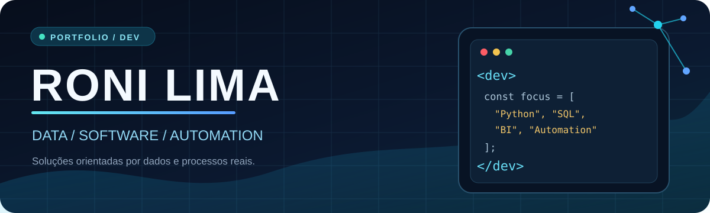
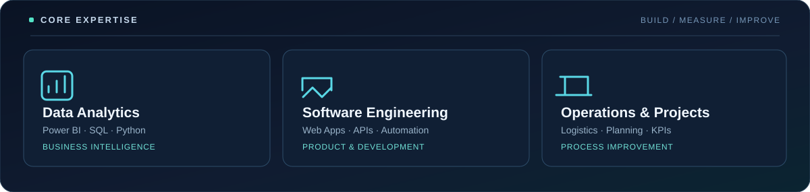

  

<h1 align="center">Roni Gomes de Lima</h1>

  <strong>Data & Business Intelligence Analyst | Software Developer | Logistics & Operations</strong>

  Desenvolvo soluções que conectam dados, software e processos operacionais — da análise de indicadores à entrega de aplicações e automações.

  
  

SÃO PAULO, BRASIL &nbsp; / &nbsp; BUSINESS INTELLIGENCE &nbsp; / &nbsp; SOFTWARE DEVELOPMENT

---

## 01 / Professional Profile

<table>
  <tr>
    <td width="65%" valign="top">
      <h3>Sobre mim</h3>
      
Profissional de <strong>análise de dados e planejamento</strong>, com vivência em operações logísticas, suporte a projetos e melhoria contínua. Combino conhecimento de negócio com desenvolvimento técnico para transformar dados em decisões e necessidades operacionais em ferramentas práticas.

      
Atuo com <strong>Power BI, DAX, SQL, Excel e Python</strong>, além de desenvolver interfaces web, aplicações, integrações e automações orientadas à eficiência e à experiência de uso.

    </td>
    <td width="35%" valign="top">
      <h3>Foco de atuação</h3>
      
<strong>Data Analytics</strong> BI, indicadores, ETL e relatórios

      
<strong>Software Development</strong> Sistemas, APIs e automação

      
<strong>Operations</strong> Logística, planejamento e projetos

    </td>
  </tr>
</table>

## 02 / Professional Experience

<table>
  <tr>
    <td width="50%" valign="top">
      MAR 2025 — ATUAL
      <h3>Candide Brinquedos</h3>
      <strong>Administrativo Logístico | Business Intelligence e Planejamento</strong>
      
Análise e tratamento de dados operacionais, desenvolvimento de dashboards em Power BI e controles em Excel. Acompanhamento de indicadores logísticos, produtividade, gargalos e oportunidades de melhoria.

      Guarulhos, São Paulo
    </td>
    <td width="50%" valign="top">
      AGO 2021 — JUL 2024
      <h3>Atento Brasil</h3>
      <strong>Especialista em Suporte Atendimento III</strong>
      
Suporte a operações B2B, demandas críticas e projetos. Relatórios gerenciais com Power BI, Salesforce e Excel; integração de informações e suporte à resolução de problemas operacionais.

      Operações e projetos
    </td>
  </tr>
</table>

## 03 / Education & Development

<table>
  <tr>
    <td width="50%" valign="top">
      <h3>Formação acadêmica</h3>
      
<strong>Análise e Desenvolvimento de Sistemas</strong> FMU | Em andamento

      
<strong>Gestão de Recursos Humanos</strong> Universidade Anhembi Morumbi | Concluído em 2022

      
<strong>MBA em Gestão de Projetos</strong>

      
<strong>Pós-graduações em Business Intelligence e Inteligência Artificial</strong>

    </td>
    <td width="50%" valign="top">
      <h3>Conhecimentos técnicos</h3>
      
<strong>Dados</strong> Power BI, DAX, Power Query, SQL, modelagem e ETL

      
<strong>Engenharia de software</strong> Python, PHP, JavaScript, React, Java e aplicações desktop

      
<strong>Plataformas</strong> Linux, Docker, Apache, bancos de dados, WMS e Oracle NetSuite

    </td>
  </tr>
</table>

---

## 04 / GitHub Analytics

PUBLIC ACTIVITY &nbsp; / &nbsp; REPOSITORY LANGUAGES &nbsp; / &nbsp; CONTRIBUTIONS

<table align="center" width="100%">
  <tr>
    <td width="50%" align="center" valign="middle">
      
    </td>
    <td width="50%" align="center" valign="middle">
      
    </td>
  </tr>
  <tr>
    <td colspan="2" align="center">
      
    </td>
  </tr>
</table>

Os gráficos refletem dados disponibilizados pelo GitHub e por serviços externos. Trabalhos em sistemas privados ou fora do GitHub podem não ser contabilizados.

---

## 05 / Technology Stack

  
  
  
  
  
  
  
  
  

---

## 06 / Featured Systems

  <strong>Inteligência operacional · Gestão de frota · Controle de pedidos</strong> 
  

<table width="100%">
  <tr>
    <td width="50%" valign="top">
      01 / DATA ANALYTICS PLATFORM
      <h3>Ruby BI — Logistics Analytics</h3>
      
Plataforma de análise logística com linguagem visual inspirada no Ruby Tower Control. Indicadores de faturamento, volumetria, frete, expedição e performance por transportadora.

      <a href="https://ronilima1810.github.io/formulario-de-matricula/portfolio-demos/ruby/"><strong>Live preview</strong></a> · <a href="https://github.com/Ronilima1810/bi-logistica">Estrutura do projeto</a>
    </td>
    <td width="50%" valign="top">
      02 / FLEET MANAGEMENT
      <h3>FleetOps — Administração de Frota</h3>
      
Produto independente para gestão de agregados, motoristas, veículos, documentos, rotas e negociação por saída, franquia de km e ajudante.

      <a href="https://ronilima1810.github.io/formulario-de-matricula/portfolio-demos/fleet/"><strong>Live preview</strong></a>
    </td>
  </tr>
  <tr>
    <td width="50%" valign="top">
      03 / OPERATIONAL CONTROL
      <h3>Order Control Center — Torre de Pedidos</h3>
      
Controle do ciclo operacional de pedidos: liberação, impressão, separação, faturamento, expedição, geração de kit, reposição e prioridades por aging.

      <a href="https://ronilima1810.github.io/formulario-de-matricula/portfolio-demos/ruby/?module=pedidos"><strong>Live preview</strong></a>
    </td>
    <td width="50%" valign="top">
      04 / DESKTOP POS / ERP WORKFLOW
      <h3>Sistema de Pedidos — PDV Desktop</h3>
      
Aplicação instalável em Windows via Electron, com frente de caixa, catálogo, estoque, venda demonstrativa e relatórios. Evolução SaaS planejada.

      <a href="https://ronilima1810.github.io/formulario-de-matricula/portfolio-demos/pdv/"><strong>Preview de interface PDV</strong></a> · <a href="https://github.com/Ronilima1810/sistema-pedidos/tree/master/desktop-pdv">Código Electron</a>
    </td>
  </tr>
  <tr>
    <td width="50%" valign="top">
      05 / FRONTEND DEVELOPMENT
      <h3>Formulário de Matrícula</h3>
      
Frontend HTML/CSS com layout responsivo e componentes customizados.

      <a href="https://ronilima1810.github.io/formulario-de-matricula/"><strong>Live site</strong></a> · <a href="https://github.com/Ronilima1810/formulario-de-matricula">Source repository</a>
    </td>
    <td width="50%" valign="top">
      06 / DESKTOP SOFTWARE
      <h3>Tradutor de Arquivos</h3>
      
Prévia web do fluxo de tradução de uma aplicação desktop desenvolvida com Python.

      <a href="https://ronilima1810.github.io/formulario-de-matricula/portfolio-demos/?demo=tradutor"><strong>Live preview</strong></a> · <a href="https://github.com/Ronilima1810/Sistemas">Source repository</a>
    </td>
  </tr>
  <tr>
    <td width="50%" valign="top">
      07 / ANDROID / KOTLIN
      <h3>FleetOps — Aplicativo Android</h3>
      
Cliente nativo Kotlin e Jetpack Compose para motoristas, criação de rotas, comprovantes e operação de última milha. Preview mobile interativo com informações fictícias.

      <a href="https://ronilima1810.github.io/formulario-de-matricula/portfolio-demos/android/"><strong>Live Android Preview</strong></a>
    </td>
    <td width="50%" valign="top">
      08 / FULL STACK ENGINEERING
      <h3>Produtos de análise e integração</h3>
      
Desenvolvimento de interfaces com React, APIs, modelagem de dados, autenticação e validação automatizada, com foco em logística e eficiência operacional.

      <a href="https://github.com/Ronilima1810/bi-logistica"><strong>React + FastAPI</strong></a> · <a href="https://ronilima1810.github.io/formulario-de-matricula/portfolio-demos/"><strong>Portfólio interativo</strong></a>
    </td>
  </tr>
</table>

<strong>Portfólio seguro:</strong> Ruby BI, FleetOps, Android, Torre de Pedidos, PDV e tradutor possuem versões demonstrativas independentes com informações fictícias, sem conexão com a produção. O formulário de matrícula mantém sua interface original. As versões demonstrativas não equivalem ao código completo dos sistemas corporativos.

---

## 07 / Engineering Principles

<strong>Business-driven development</strong> — Soluções pensadas para processos e necessidades reais.

<strong>Usability &amp; clarity</strong> — Interfaces legíveis, consistentes e orientadas à experiência.

<strong>Data &amp; automation</strong> — Integração entre informações, indicadores e execução.

<strong>Security by design</strong> — Separação entre demonstrações públicas, dados pessoais, credenciais e sistemas proprietários.

  RONI GOMES DE LIMA &nbsp; / &nbsp; DATA · SOFTWARE · OPERATIONS

